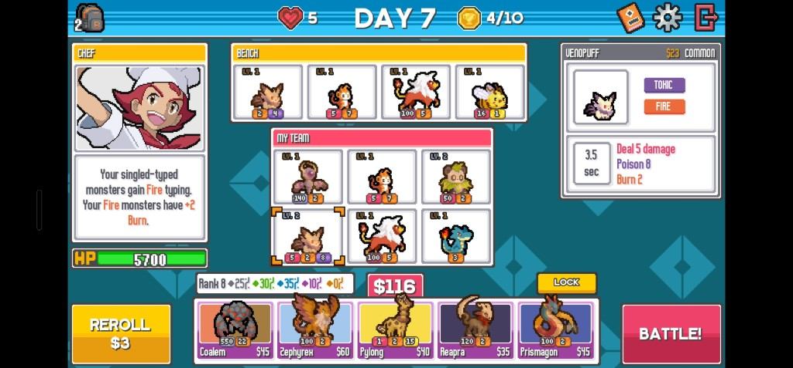

# 003 — The Run Shop and the Game-Shaped Board Layout

**Specification only. Nothing is built.**

Rebuilds the Calculator view around the shape of the game's own shop screen: a five-offer shop row
with prices and rarity, a run economy the advisor can reason about, and a page layout whose regions
match where the game puts them.

## Read in this order

| Document                                     | What it answers                                                                                                       |
| -------------------------------------------- | --------------------------------------------------------------------------------------------------------------------- |
| [`spec.md`](./spec.md)                       | What it is: user stories, functional requirements, success criteria                                                   |
| [`data-model.md`](./data-model.md)           | The run-state systems: economy, shop offers, acquisition sources, what persists, what the engine gains                |
| [`ui-architecture.md`](./ui-architecture.md) | The layout shell, the DOM restructuring, the breakpoint strategy, the component inventory, where the analysis UI goes |

## Decisions taken (2026-10-13)

The draft left nine things open. All nine are now settled; this is the record.

| #   | Decision                                                                                                                   | Consequence                                                                                                                                                                                         |
| --- | -------------------------------------------------------------------------------------------------------------------------- | --------------------------------------------------------------------------------------------------------------------------------------------------------------------------------------------------- |
| D1  | **Transcribed, not simulated.** You enter the five offers your real shop is showing                                        | No RNG, no run loop, no odds table. Rerolling to chase a monster is the time-waste the app exists to avoid                                                                                          |
| D2  | **Acquisition sources replace the tri-state price.** Each species _and level_ is tagged with where it can be obtained from | Supersedes the draft's `number \| null \| undefined`. The shop offers only shop-obtainable monsters, and "sold but unpriced" becomes a test-enforceable defect rather than an indistinguishable `0` |
| D3  | **An explicit selection model lands before the layout moves**                                                              | Hover-only has no touch path; confirmed as step 2 of the sequence                                                                                                                                   |
| D4  | **`DndContext` is lifted out of `GridPicker`**                                                                             | Board, bench and shop become independent regions sharing one provider                                                                                                                               |
| D5  | **`ShopRef` stays separate from `RosterRef`**                                                                              | "Owned" and "offered" are different types, so a future session cannot blur them by accident                                                                                                         |
| D6  | **Two viewport breakpoints, three layout states; everything else is a container query**                                    | 1024px and 1280px, both derived from the token chain. See `ui-architecture.md` §3.3                                                                                                                 |
| D7  | **Extract a `Sheet` primitive first**                                                                                      | Four consumers from day one; `TeamLibrary` migrates onto it as the proof                                                                                                                            |
| D8  | **The "Cockpit" information architecture**                                                                                 | DPS / mitigation / time-to-kill live in the status bar; the advisor headline docks beside the board; tables and charts move into an analysis sheet. See `ui-architecture.md` §10                    |
| D9  | **Shop rank and rarity odds are dropped entirely**                                                                         | Their only consumer was reroll expected value, which only exists under D1's rejected alternative — and trinkets/items/trainers modify shop rank, so any static table would be wrong anyway          |

## The two things that still block a start

The draft listed three. D2 and D3 turned one of them into a plan, so two remain as work:

1. **62 of 149 species carry `shopCost: 0`, and 56 of those are not evolution targets.** Tagging
   acquisition sources (D2) makes the set diagnosable, but it does not make the prices appear. The
   subset tagged `Shop` still needs real numbers. See `data-model.md` §4 for the enumerated list and
   the invariant test that keeps it honest.
2. **`#root` imposes `width: max(1126px, …)` and `text-align: center`.** Both have to go before a
   grid shell can place anything. See `ui-architecture.md` §7.1.

## What this changes about advice

The bench is currently modelled as monsters you already own, and the lineup search prices them at
zero gold. On a real shop screen that produces unactionable recommendations — on the board that
prompted this feature it advised fielding two monsters costing $75 against a $55 budget, while the
best affordable board (Aristobat + Runerock, $45) was never surfaced.

Making `rosterAdvice` budget-aware is roughly 80 lines, needs no shop UI at all, and is step 4 of
the sequence rather than something that waits for the layout.

## Relationship to 001

This is a **round of 001**, not a spin-off. It changes `TeamConfiguration`, the engine's advisor and
most of the UI layer, so it belongs to the same feature. It lives in its own folder only because the
document set is large enough that appending it to `001/spec.md`'s amendment log would bury it;
accepted requirements should be folded back into `001/spec.md` as an amendment round when this ships.

`.specify/feature.json` still points at 001, so `/speckit-plan` and `/speckit-tasks` operate on that
directory, not this one.
